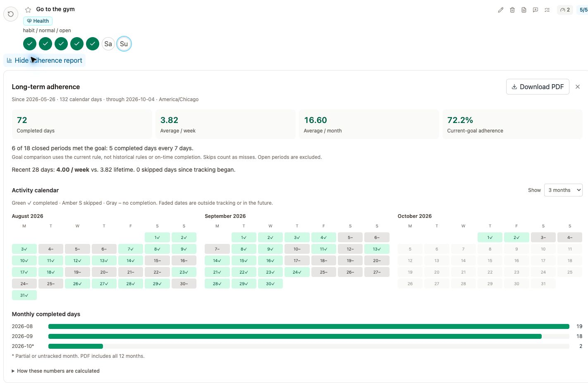
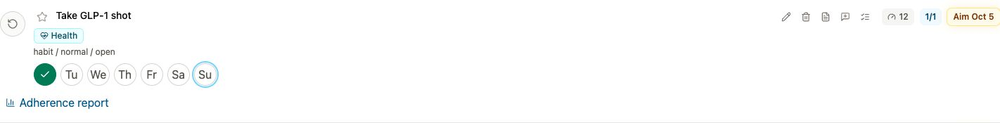
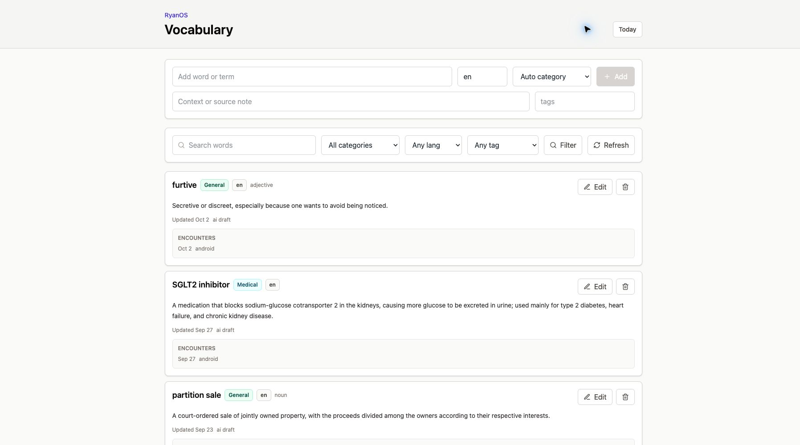
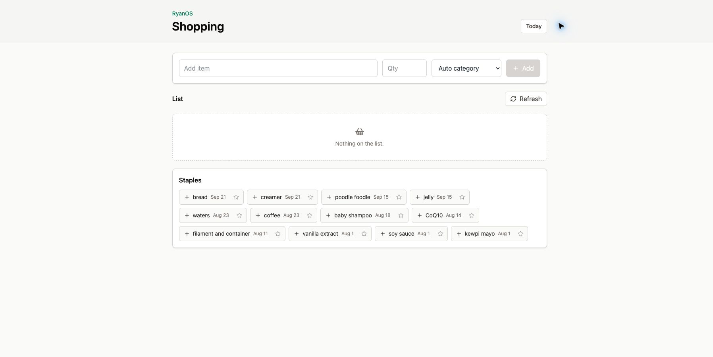

# RyanOS

RyanOS is a self-hosted, AI-first personal operating system that turns everyday
language into tasks, routines, calendar plans, and follow-through. It brings
email, opportunities, goals, medication schedules, vocabulary, and shopping into
one persistent workspace, accessible from the web, Telegram, and Android.

Tell it what happened or what needs doing: “I went to the gym,” “add eggs to my
shopping list,” or “save this word.” AI interprets the request into typed tools;
deterministic handlers validate permissions, update state, enforce recurrence
rules, and record an audit trail.

## The OpenClaw Parallel

Like [OpenClaw](https://github.com/openclaw/openclaw), RyanOS follows the idea of
a personal AI assistant running on infrastructure you control, reachable through
chat, and connected to tools that can take action. RyanOS applies that pattern
to a structured personal workspace: tasks, completion history, recurrence
policies, opportunity proposals, and calendar plans live in a database and have
purpose-built interfaces alongside the conversation.

The shared ambition is an assistant that helps you act and follows through over
time. RyanOS emphasizes the details of daily life: when a routine is actually
eligible again, which neglected task deserves attention, whether an email needs
a to-do, and how consistently you have worked toward a goal. RyanOS is an
independent project; it does not require OpenClaw.

## Integrations and Capabilities

- **Email / Gmail:** scheduled inbox scans identify actionable messages and
  propose tasks, replies, and follow-ups with source links, confidence scores,
  due dates, progress notes, and checklists. Accept or reject proposals and tune
  sender preferences before they become part of your task list.
- **RFP, grant, and job-search workflows:** ingest structured opportunity reports
  from external automations, including Codex searches. Review fit ratings,
  rationale, source links, deadlines, decision dates, and recommended next
  steps; accepted proposals become actionable work. RFP/grant intake is
  implemented; job-search results can use the same candidate-report format
  rather than a dedicated job-board connector.
- **Goal and habit tracking:** track targets such as “go to the gym five times
  per week” without requiring a rigid daily schedule. Record and undo individual
  days, distinguish intended dates from actual completion, and inspect long-term
  adherence, completion counts, weekly/monthly averages, and downloadable PDF
  reports. Completing one occurrence keeps the recurring item active.
- **Medication and complex recurrence tracking:** combine fixed schedules,
  completion-based intervals, minimum spacing, and target frequencies. Examples
  include a GLP-1 reminder whose next due date is seven days after the recorded
  completion, a “not sooner than seven days” rule that flags an early
  completion, a fixed Monday reminder, or a routine performed five times in a
  seven-day window. These are tracking examples
  for a schedule you supply, not dosing recommendations.
- **Google Calendar:** sync selected calendars, inspect an agenda, create events,
  and draft a day of task blocks around existing availability and scheduling
  rules. Review a draft plan before publishing its blocks to Google Calendar.
- **Automatic task priority ascension:** tasks rise in the dashboard as deadlines
  approach, become overdue, or recurring goals fall behind. Scores account for
  base priority, opportunity work, days since completion, and remaining target
  counts. Upcoming recurring items stay quiet until their attention window;
  completed targets fall back down. Each score has explanatory signals.
- **Complex vocabulary tracking:** maintain an editable dictionary for ordinary
  words, medical and technical terminology, slang, proper nouns, and foreign
  languages. Save definitions, pronunciation, parts of speech, translations,
  notes, and tags; retain encounter context and source links, merge duplicates,
  filter by language/category/tag, and request AI-drafted definitions.
- **Shopping:** a separate categorized shopping list with natural-language
  capture, quantities, units, notes, purchase tracking, and reusable staples, available on web and
  Android.
- **Android app and home-screen widgets:** a native Material 3 companion with
  Today, Shopping, Vocabulary, Chat, and Settings. Task, shopping, and vocabulary
  widgets provide quick access; task widgets support completion and recurring
  day actions. Local cached payloads and background refresh keep widgets useful
  between app launches. See [Android setup](./apps/android/README.md).
- **Telegram and web chat:** use the same assistant pipeline from either surface,
  with persisted conversations, Telegram account linking, typing feedback, and
  protection against duplicate message delivery.
- **Daily focus, projects, and progress:** organize work into areas and projects,
  star today's focus, track checklists and dated progress notes, and snooze work
  until it becomes relevant.
- **Louisiana lottery information:** optional draw-game data and a licensed-retailer
  finder link for informational queries.
- **Self-hosted operations:** PostgreSQL-backed state, a background worker,
  encrypted integration credentials, self-hosted authentication, and an Admin
  workspace for connection setup, health diagnostics, and AI smoke tests.

## Screenshots

The screenshots below show the running application. Views are cropped to keep
private account details and unrelated personal items out of the public README.



*Gym tracking combines weekly completion targets with long-term adherence and
PDF export.*



*Recurring reminders keep actual completions separate from the next intended
date.*



*An editable dictionary with categories, languages, definitions, and encounter
context.*



*Shopping has its own workspace, separate from tasks and goals.*

## Architecture and Status

RyanOS has a working web dashboard, Fastify API, PostgreSQL/Drizzle persistence,
Graphile Worker jobs, and a native Android companion. The TypeScript workspace
shares typed tools and domain logic across the assistant and application.
Integration availability depends on the accounts and credentials you configure.
AI interpretation can use the host Codex bridge; your configured AI provider
receives the context needed for those requests. Self-hosting the application
does not make every connected service or model local.

## Planning Docs

- [ARCHITECTURE.md](./ARCHITECTURE.md): system architecture and accepted stack.
- [MESSAGE_PIPELINE.md](./MESSAGE_PIPELINE.md): AI-first message and agent loop.
- [TOOL_CONTRACTS.md](./TOOL_CONTRACTS.md): AI-callable tool boundary.
- [DATA_MODEL.md](./DATA_MODEL.md): PostgreSQL/Drizzle data model.
- [IMPLEMENTATION_PLAN.md](./IMPLEMENTATION_PLAN.md): V1 through V2 build plan.

## Local Dev

Docker is the preferred local development path.

1. Copy env: `cp .env.example .env`
2. Start web, API, and Postgres: `pnpm docker:up`
3. Dashboard: `http://localhost:3100`
4. API health: `http://localhost:4100/health`
5. Setup status: `http://localhost:4100/v1/setup/status`
6. Admin diagnostics: `http://localhost:3100/admin`

The Compose setup binds host ports to `127.0.0.1`, keeps Postgres on a
non-default host port by default, mounts source into containers, and stores root
and workspace package `node_modules` in named volumes so host installs do not
fight Docker installs.

Default Docker host ports are `WEB_PORT=3100`, `API_PORT=4100`, and
`DB_HOST_PORT=54334`. The API and web containers still listen on their normal
internal ports; only the host bindings move.

Browser access to the API is intentionally origin-scoped. For local development,
`RYANOS_CORS_ORIGINS` defaults to `http://localhost:3100,http://127.0.0.1:3100`.
Add the eventual LAN, Tailscale, or public dashboard origin there before using
that access path.

Local development defaults to `RYANOS_AUTH_MODE=dev-local`, so the dashboard can
open without sign-in while iterating. To test real auth locally, set
`RYANOS_AUTH_MODE=required`, `BETTER_AUTH_SECRET`, `BETTER_AUTH_URL`, and
`RYANOS_INVITE_CODES` in `.env`, then create an account from the dashboard.
Better Auth is used as a self-hosted library in the API process, backed by
Postgres; no Better Auth hosted service is required.

Set `RYANOS_SUPERADMIN_EMAILS` to bootstrap deployment admins; matching users are
promoted on login and are not demoted automatically if the env value changes.

When RyanOS needs a human setup action, such as Codex login or a Telegram bot
token, it should expose that through Admin integrations or setup status instead
of failing silently or working around the missing connector.

## Local Secrets

RyanOS stores long-lived integration credentials encrypted in Postgres. The
database backup contains ciphertext only; the master key lives outside the
database in `secrets/master-key`.

Generate the local master key:

```bash
pnpm secrets:generate-key
```

Telegram setup stores the bot token encrypted in Postgres. In normal deployments,
paste the token into Admin -> Integrations -> Telegram while signed in as a
superadmin. The CLI import remains available as a fallback:

```bash
# after creating a bot with BotFather, put the token in secrets/telegram-bot-token
docker compose exec api pnpm telegram:store-token -- --file /app/secrets/telegram-bot-token
```

`TELEGRAM_BOT_TOKEN` remains a development fallback, but the preferred path is
encrypted DB storage plus a separately backed-up master key.

For local testing, start the Telegram poller:

```bash
pnpm docker:telegram
```

Then inspect the logs for the bot username:

```bash
docker compose logs -f telegram-poller
```

Open that bot in Telegram and send `/start` or any plain text message. RyanOS
will ingest the message through the same `/v1/inbound/telegram` path used by
future webhooks.

The poller sends a Telegram typing action while RyanOS is processing a message.
Disable it with `TELEGRAM_SEND_TYPING=false` or tune the heartbeat with
`TELEGRAM_TYPING_INTERVAL_MS`.

For Docker-backed AI interpretation through the logged-in Codex app, run the
host bridge:

```bash
RYANOS_CODEX_BRIDGE_HOST=0.0.0.0 RYANOS_CODEX_BRIDGE_TOKEN=<local token> pnpm codex:bridge
```

The Docker API uses `RYANOS_CODEX_BRIDGE_URL` and
`RYANOS_CODEX_BRIDGE_TOKEN` from `.env`. Keep the bridge local-only; do not
expose it publicly.

Use the Admin page's AI smoke test to verify that the bridge can complete a
structured no-tool interpretation, not just report that the CLI is logged in.
The same page exposes the attention-scoring debug view.

While Docker services are running, treat dependencies as Docker-owned. To switch
back to direct host development, stop the services and run:

```bash
pnpm install --force
```

For direct host development, use Node `20.20.0` from `.node-version`, then run:

```bash
pnpm install
pnpm build
pnpm test
```

## License

RyanOS is source-available under the Functional Source License 1.1 with an
Apache 2.0 future license. You can inspect, self-deploy, modify, and contribute
to the project, but competing commercial products and hosted services require a
separate commercial license.

- [LICENSE.md](./LICENSE.md): controlling public license.
- [COMMERCIAL.md](./COMMERCIAL.md): practical commercial-use guidance.
- [TRADEMARKS.md](./TRADEMARKS.md): RyanOS brand usage rules.
- [CONTRIBUTING.md](./CONTRIBUTING.md): contribution terms.

RyanOS should be described as source-available or Fair Source, not open source,
until a specific version converts to Apache 2.0 under the future-license grant.
